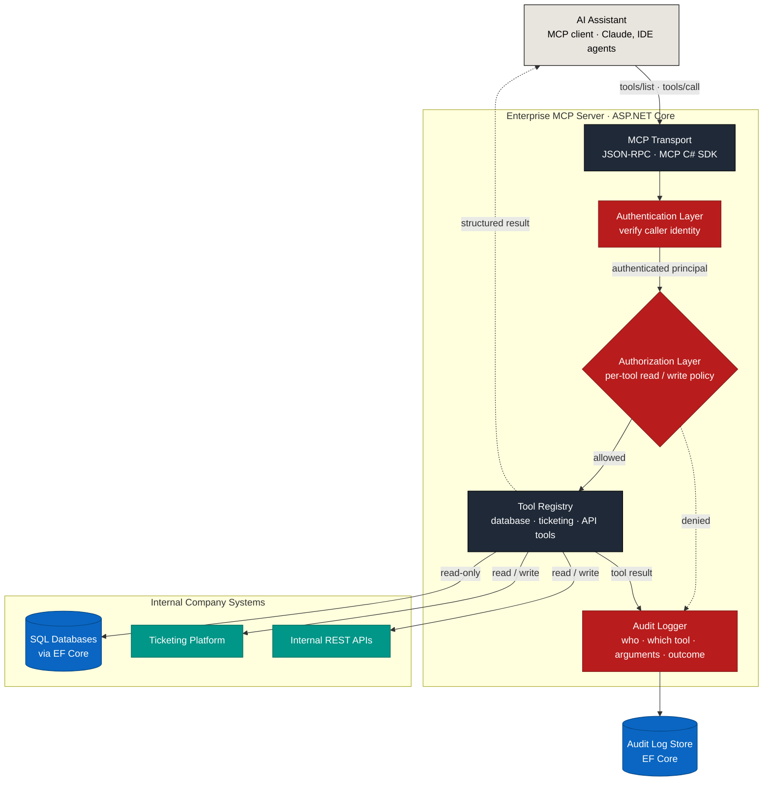
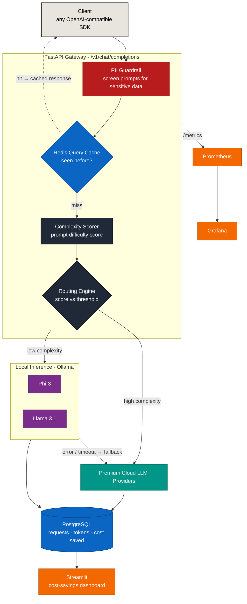
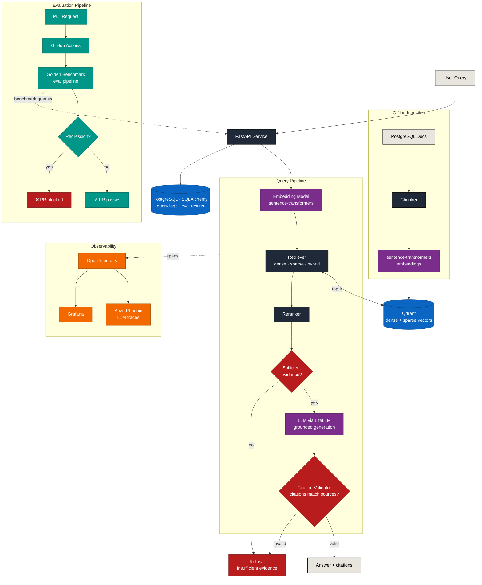
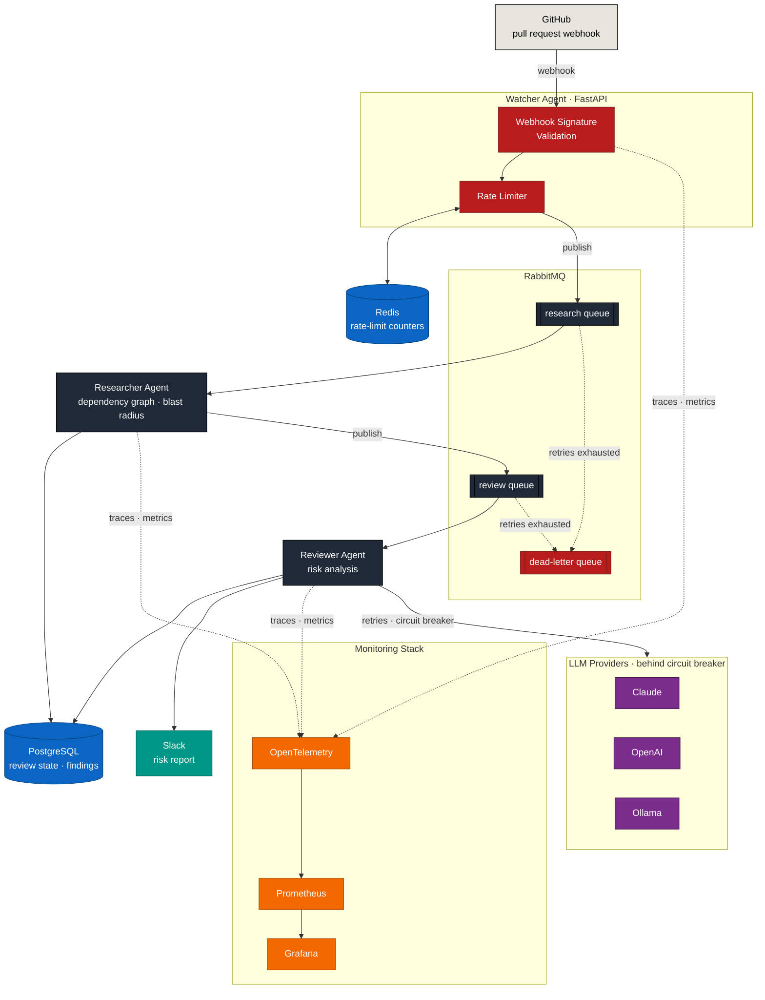
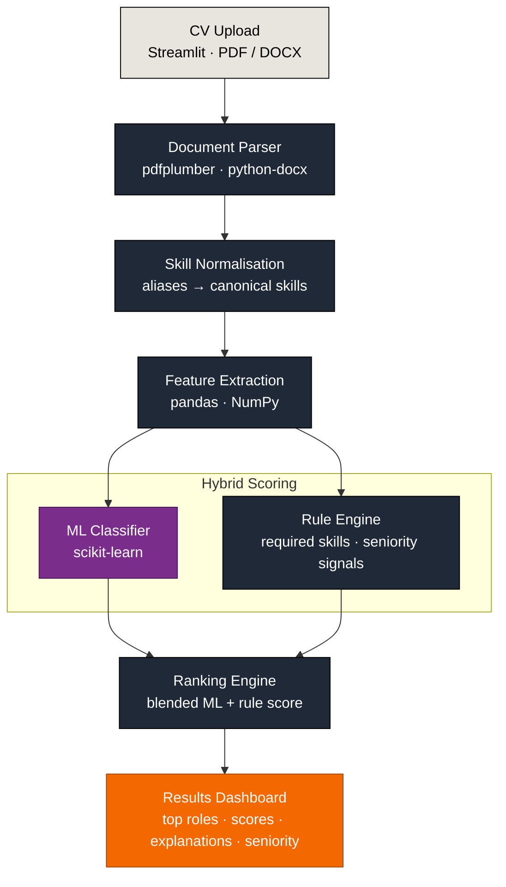
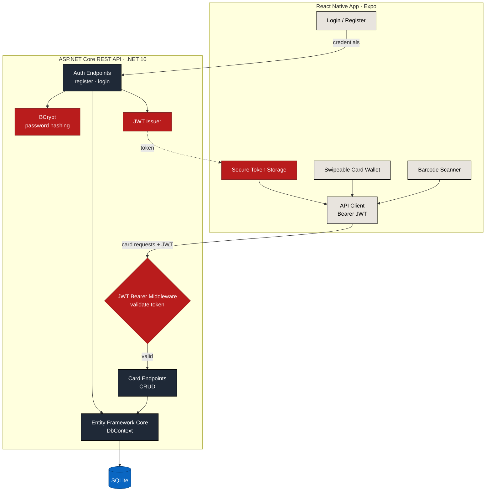
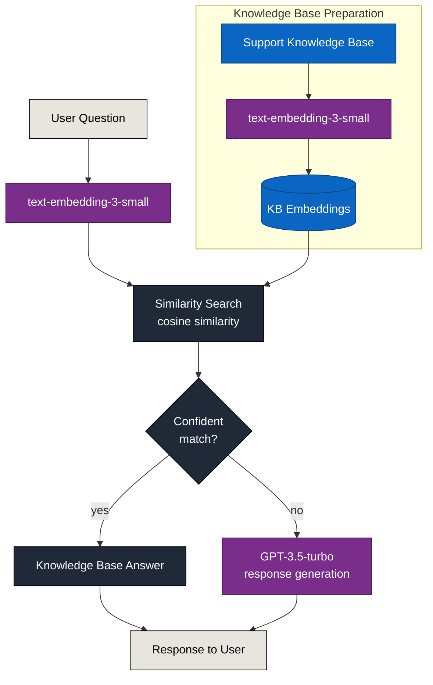

<!-- ============================================================ -->
<!-- GITHUB PROFILE README · StealthyPete12                        -->
<!-- ============================================================ -->

<!-- ======================= HEADER ============================= -->

[)](https://git.io/typing-svg)

**Software Engineer · Backend & AI Systems · Distributed Systems · Platform & Observability**

I design and build production-grade backend and AI systems — tested, containerised and observable by default.

 

<!-- ===================== ABOUT ME ============================= -->

## 

I'm a **backend and AI-focused software engineer** working in **Python** and **C#/.NET**. I build systems like event-driven multi-agent pipelines, hallucination-resistant RAG services, cost-aware LLM routers, and secure gateways that connect AI assistants to company systems.

I engineer every project the way production teams do: **automated tests, CI pipelines, Docker, distributed tracing and metrics**, with failure handling such as retries, dead-letter queues and circuit breakers designed in from the first commit.

I'm most interested in **distributed systems, platform engineering, observability and cloud infrastructure** — the layers that keep software correct, resilient and debuggable once it's running for real.

> [!NOTE]
> **Currently building:** an **Enterprise MCP Server in C#** that lets AI assistants connect *safely* to company systems — with authentication, per-tool permissions and full audit logging.

**Education:** Final-year **Bachelor of Business Informatics** at **UNISA**.

**Background:** Before engineering, I spent almost four years in technical recruitment, working with engineering managers across **South Africa, Switzerland, the UK, the US and Europe**. That gave me a close-up view of how high-performing engineering teams are structured and make decisions. I bring that perspective and strong communication skills to every team I work in.

**Seeking:** Graduate Software Engineer · Backend Engineer · AI Engineer · Platform Engineer roles.

**Certifications:** Databricks Generative AI Fundamentals | DataCamp AI Engineer for Developers | Microsoft Azure AI Fundamentals | Azure AI Engineer Associate *(in progress)*

**Methodologies:**

 

---

<!-- ==================== TECH STACK ============================ -->

## 

&nbsp;&nbsp;
&nbsp;&nbsp;
&nbsp;&nbsp;
&nbsp;&nbsp;
&nbsp;&nbsp;
&nbsp;&nbsp;
&nbsp;&nbsp;
&nbsp;&nbsp;
&nbsp;&nbsp;
&nbsp;&nbsp;
&nbsp;&nbsp;
&nbsp;&nbsp;
&nbsp;&nbsp;
&nbsp;&nbsp;
&nbsp;&nbsp;
&nbsp;&nbsp;

&nbsp;&nbsp;
&nbsp;&nbsp;
&nbsp;&nbsp;
&nbsp;&nbsp;
&nbsp;&nbsp;
&nbsp;&nbsp;
&nbsp;&nbsp;
&nbsp;&nbsp;
&nbsp;&nbsp;

<b>Full toolbox by category</b>

 

| Area | Technologies |
|:--|:--|
| **Languages** |     |
| **Frameworks** |  -512BD4?style=flat-square&logo=dotnet&logoColor=white)  -000020?style=flat-square&logo=expo&logoColor=white)  |
| **AI & ML** |         |
| **Data & Messaging** |     |
| **DevOps & Observability** |      |
| **Cloud** |   |

---

<!-- ================= ENGINEERING PRACTICES ==================== -->

## 

| Practice | What it looks like in my projects |
|:--|:--|
| 🧪 **Testing** | `pytest` suites on every Python project — **234 automated tests** incl. chaos tests in Code Review Swarm |
| 🔁 **CI/CD** | GitHub Actions pipelines, including **automated RAG benchmark regression checks on every PR** |
| 🐳 **Containers** | Docker & Docker Compose for reproducible, one-command local environments |
| 📈 **Observability** | OpenTelemetry tracing, Prometheus metrics, Grafana dashboards, Arize Phoenix for LLM traces |
| 🛡️ **Resilience** | Retries, dead-letter queues, circuit breakers, rate limiting, local-to-cloud fallback |
| 🔐 **Security** | JWT auth, BCrypt hashing, PII guardrails, per-tool authorization and audit logging for AI actions |

---

<!-- ================== FEATURED PROJECTS ======================= -->

## 

<table>
<tr>

<td colspan="2" valign="top">

### 🛠️ Enterprise MCP Server &nbsp;

A Model Context Protocol server in C# that exposes SQL databases, ticketing platforms and internal REST APIs as **AI-callable tools** — with authentication, per-tool read/write permissions and full audit logging.

[Architecture ↓](#1-enterprise-mcp-server)

</td>

</tr>
<tr>

<td width="50%" valign="top">

### ⚡ Local SLM Router API

OpenAI-compatible API that scores prompt complexity and routes to **local SLMs or premium cloud models** — with PII guardrails, caching, fallback and cost-savings tracking.

[Repo](https://github.com/StealthyPete12/SLM-Router-API) · [Architecture ↓](#2-local-slm-router-api)

</td>

<td width="50%" valign="top">

### 🎯 Anti-Hallucination RAG

RAG over the PostgreSQL docs that **validates citations and refuses to answer** without evidence — gated by a golden benchmark on every PR.

[Repo](https://github.com/StealthyPete12/Anti-Hallucination-System) · [Architecture ↓](#3-anti-hallucination-rag-system)

</td>

</tr>
<tr>

<td width="50%" valign="top">

### 🐝 Code Review Swarm

Event-driven **multi-agent** code review over RabbitMQ with dead-letter queues, retries, circuit breakers and **234 tests incl. chaos testing**.

[Repo](https://github.com/StealthyPete12/Multi-Agent) · [Architecture ↓](#4-code-review-swarm)

</td>

<td width="50%" valign="top">

### 🧑‍💼 AI Candidate Role Matcher

ATS-style app that parses PDF/DOCX CVs and ranks the **top matching technical roles** using ML plus rule-based scoring, with explanations and seniority estimates.

[Repo](https://github.com/StealthyPete12/AICandidate-System) · [Architecture ↓](#5-ai-candidate-role-matcher)

</td>

</tr>
<tr>

<td width="50%" valign="top">

### 💳 Cardy

Full-stack mobile wallet: **ASP.NET Core REST API** with JWT + BCrypt, and a **React Native** app with barcode scanning and swipeable cards.

[Repo](https://github.com/StealthyPete12/Cardy) · [Architecture ↓](#6-cardy--full-stack-mobile-wallet)

</td>

<td width="50%" valign="top">

### 💬 Customer Support Chatbot

Support bot using **OpenAI embeddings** for semantic search over a knowledge base, falling back to GPT generation when no confident match exists.

[Repo](https://github.com/StealthyPete12/DataCamp-Chatbot) · [Architecture ↓](#7-customer-support-chatbot)

</td>

</tr>
</table>

---

<!-- ================ ARCHITECTURE DEEP DIVES =================== -->

## 

<b>Diagram key:</b> ⬜ clients · ⬛ core services · 🟥 security & failure paths · 🟪 AI / models · 🟦 data stores · 🟧 observability · 🟩 external services

### 1. Enterprise MCP Server

A Model Context Protocol server that lets AI assistants use company systems as tools — **without giving them the keys to everything**. Every call is authenticated, checked against a per-tool permission policy, and written to an audit trail.

**Key features**
- Exposes SQL databases, ticketing platforms and internal REST APIs as MCP tools
- Authentication and authorization layers in front of every tool invocation
- Tool-level **read-only vs write** permissions
- Full **audit logging** of every AI-initiated action, including denied attempts

**Technical highlights**
- Built on the official **Model Context Protocol C# SDK** and ASP.NET Core
- Security-first design: least privilege for AI agents is enforced server-side, not trusted to the model

---

### 2. Local SLM Router API

A drop-in **OpenAI-compatible** endpoint that sends simple prompts to cheap local models and only escalates to premium cloud LLMs when the prompt actually needs it — tracking every dollar saved.

**Key features**
- OpenAI-compatible API — existing clients switch over by changing the base URL
- Prompt **complexity scoring** drives local-vs-cloud routing
- **PII guardrails** before any prompt leaves the gateway
- Redis **query caching** and automatic **local-to-cloud fallback**
- Per-request **cost-savings tracking** in PostgreSQL with a Streamlit dashboard

**Technical highlights**
- Whole stack spins up with **Docker Compose**
- **Prometheus** metrics and **Grafana** dashboards for the router
- Tested with `pytest`

[**View repository →**](https://github.com/StealthyPete12/SLM-Router-API)

---

### 3. Anti-Hallucination RAG System

A RAG system over the **PostgreSQL documentation** that would rather say *"I don't know"* than make something up. Answers must be backed by retrieved evidence and valid citations, and retrieval quality is guarded by a benchmark that runs on every pull request.

**Key features**
- **Source citation validation** — answers whose citations don't match retrieved chunks are rejected
- **Refuses to answer** when the retrieved evidence is insufficient
- **Golden benchmark** evaluation framework for measurable answer quality
- **Automated PR regression testing** in GitHub Actions
- Retrieval experiments comparing **dense, sparse, hybrid search and reranking**

**Technical highlights**
- Provider-agnostic LLM calls through **LiteLLM**
- End-to-end tracing with **OpenTelemetry → Arize Phoenix**, dashboards in **Grafana**
- Treats retrieval quality like code quality: no merge if the benchmark regresses

[**View repository →**](https://github.com/StealthyPete12/Anti-Hallucination-System)

---

### 4. Code Review Swarm

An **event-driven, multi-agent** code review system. Three specialised agents communicate over RabbitMQ, each doing one job well, with the failure handling you'd expect in production distributed systems.

**Key features**
- **Watcher Agent** validates GitHub webhooks and enforces Redis-backed rate limits
- **Researcher Agent** builds dependency graphs and calculates the **blast radius** of a change
- **Reviewer Agent** performs LLM-powered risk analysis and posts reports to **Slack**
- Multi-provider LLM support: **Claude, OpenAI and local Ollama models**

**Technical highlights**
- **Dead-letter queues, retries and circuit breakers** for graceful failure handling
- **234 automated tests**, including **chaos testing** of failure scenarios
- Distributed tracing and metrics across all agents with **OpenTelemetry, Prometheus and Grafana**
- Containerised with Docker and tested in **GitHub Actions** CI

[**View repository →**](https://github.com/StealthyPete12/Multi-Agent)

---

### 5. AI Candidate Role Matcher

An **ATS-style** CV matching engine that applies real hiring domain knowledge to a hybrid ML system. It reads PDF and DOCX CVs, normalises skills, and combines a machine-learning classifier with rule-based logic to rank the best-fit technical roles — and explains *why*.

**Key features**
- Reads **PDF and DOCX** CVs
- Ranks the **top matching technical roles** with scores
- Generates human-readable **explanations** for each match
- Estimates candidate **seniority**

**Technical highlights**
- **Hybrid decision system**: ML predictions combined with explicit, auditable business rules
- Skill normalisation and rules encode domain knowledge from almost four years of technical hiring

[**View repository →**](https://github.com/StealthyPete12/AICandidate-System)

---

### 6. Cardy · Full-Stack Mobile Wallet

-512BD4?style=flat-square&logo=dotnet&logoColor=white)

A mobile wallet for loyalty and shopping cards — scan a barcode or add a card manually, then swipe to it at checkout. Backed by a secure **ASP.NET Core REST API**.

**Key features**
- **JWT authentication** with **BCrypt** password hashing
- Secure user storage via Entity Framework Core + SQLite
- **Barcode scanning** and manual card entry
- **Secure on-device token storage** and a swipeable card experience

**Technical highlights**
- Clean separation between mobile client, REST API and persistence layer
- Protected endpoints enforced by JWT bearer middleware on the server

[**View repository →**](https://github.com/StealthyPete12/Cardy)

---

### 7. Customer Support Chatbot

A customer support chatbot that answers from a curated knowledge base using **semantic similarity search**, and falls back to GPT generation only when no confident match exists.

**Key features**
- Semantic search with OpenAI **text-embedding-3-small**
- Retrieves the most relevant knowledge-base content for each question
- **Confidence-based fallback** to GPT-3.5-turbo when no strong match exists

[**View repository →**](https://github.com/StealthyPete12/DataCamp-Chatbot)

---

**Open to:** Graduate Software Engineer · Backend Engineer · AI Engineer · Platform Engineer

Designing systems that are tested, observable and built to survive production.

